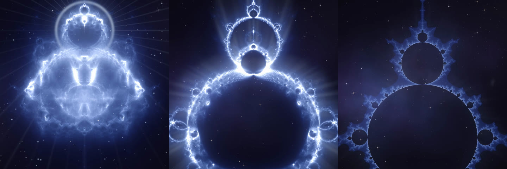

# Divine Buddhabrot



A 20-second seamless loop: a Buddha made of light turns through four dimensions into the
Mandelbrot set and back, while the camera drifts through a procedural universe.
Video: [`divine_buddhabrot.mp4`](divine_buddhabrot.mp4) (1080p, 30 fps).

## 1. The Mandelbrot set

Take a complex number `c`. Start with `z = 0` and repeat

```
z → z² + c
```

If `z` stays bounded forever, `c` is in the Mandelbrot set. If it escapes to infinity, `c` is
outside. Once |z| > 2, `z` is certain to escape, so we stop counting there.

## 2. The Buddhabrot

Same formula, different question. Instead of colouring the starting point `c`, we **draw the
whole path z₁, z₂, z₃ … that z takes on its way out**:

1. Pick hundreds of millions of random `c`.
2. Keep the ones that escape.
3. Replay each path and add +1 to every pixel it passes through.

The density of all those escape paths looks like a seated Buddha (Melinda Green, 1993).

**Colour ("moonlight").** We mix the counts from paths of different lengths into one density,
turning down the short paths, which form a broad haze. That keeps the hollows of the head and
belly dark, and the dark hollows against bright rims are what make the figure look carved out
of light. The density is then coloured by raising it to a different power per channel:

```
red = d^1.6    green = d^1.25    blue = d^0.8
```

Blue rises first, so faint light is deep blue, brighter light is icy blue, and only the densest
rims turn white. Empty space stays black.

## 3. The animation: turning through 4D

Every point on a path has four numbers, `(Re z, Im z, Re c, Im c)`. Looking at the `z` plane
shows the **Buddha**. Looking at the `c` plane shows the **Mandelbrot set**, because every
path point lands on its own `c`. We rotate between the two views by an angle θ:

```
screen_vertical   = Re z · cos θ + Re c · sin θ
screen_horizontal = Im z · cos θ + Im c · sin θ
```

θ moves smoothly 0° → 90° → 0°. The Buddha opens up, becomes an eclipse-like ring, and then
becomes the Mandelbrot set.

While the Buddha is visible, a few elements from Buddhist iconography sit behind it:
- a halo ring
- a sunburst of thin rays
- a small jewel on the brow
- motes of light drifting upward

All of them fade away as it turns.

## 4. How it runs on CUDA

The camera moves, but the paths never change, so the work is split in two.

**Once, at startup (about 0.5 s):**
- 2²⁸ ≈ 268M random `c` are tested in parallel, one thread each.
- Points inside the two big blobs of the set are skipped with a closed-form test.
- Trapped points are caught early by cycle detection.
- About 24M escaping `c` are kept and sorted by path length. GPU threads run in lockstep
  groups of 32, so similar lengths mean nobody waits for a slow neighbour.

**Every frame (about 70 ms on an A100):**
1. **Draw.** One thread per kept `c` replays its path through the 4D camera and adds to pixel
   counters with `atomicAdd`. This is about 85% of the frame time. The bottom half of the
   image is the mirror of the top, so each path is drawn twice for free.
2. **Normalize.** Find a "full brightness" level per band (the 99.9th percentile), and
   auto-expose so the thin Mandelbrot frames stay visible.
3. **Light.** Glows (gaussian blurs), light rays (a radial blur), and the halo. All of it sits
   *behind* the figure, so the face stays crisp.
4. **Universe.** An infinite-zoom starfield (four copies at doubling sizes that fade in and
   out), fractal-noise nebulae, and a Milky Way band.
5. **Output.** Raw RGB frames are piped to `ffmpeg`.

**One subtle bug worth knowing about:** the escape test and the replay must do *identical*
floating-point arithmetic. Long paths are chaotic, so if the compiler fuses one multiply-add
differently, the replay drifts, blows up, and dumps garbage into one pixel. The shared `step()`
uses explicit rounding intrinsics (`__fmul_rn`, `__fadd_rn`) to prevent that.

## Run

```bash
./render.sh                      # 1920x1080, 20 s, 30 fps  -> divine_buddhabrot.mp4
./render.sh 1920 1080 20 60      # same loop at 60 fps
./render.sh 3840 2160 20 30 29   # 4K, 2^29 samples
```

`render.sh` compiles with `-arch=sm_80` (A100). Change it to match your GPU, e.g. `sm_86`
for RTX 30-series or `sm_89` for RTX 40-series.

| | |
|---|---|
| GPU | NVIDIA A100 |
| Paths kept | 24.4M of 268M samples |
| Speed | ~15 fps at 1080p |
| 20 s loop (600 frames) | ~55 s to render |
